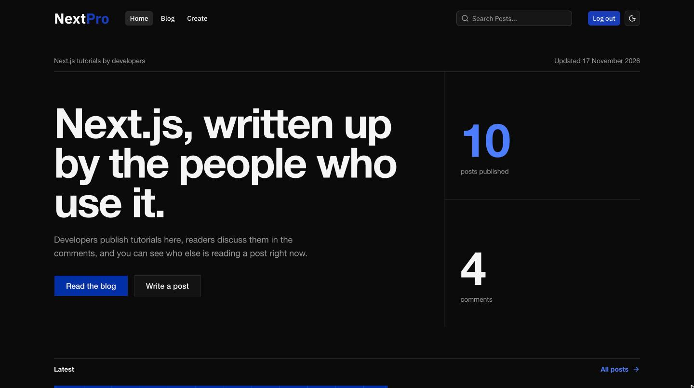
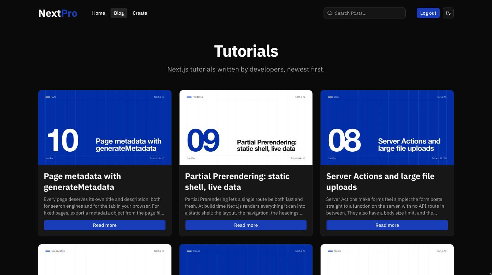
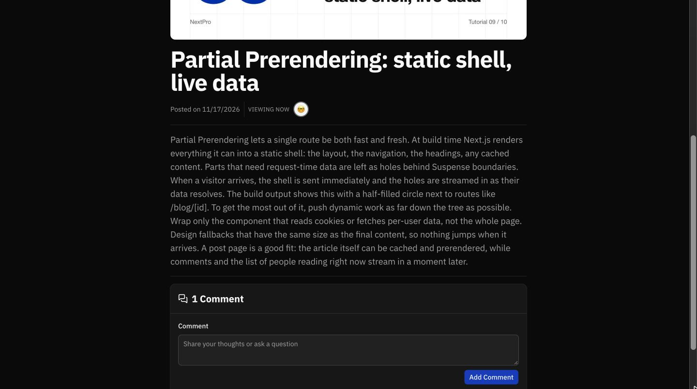

# NextPro — Next.js tutorials by developers

A publishing platform where developers write Next.js tutorials, readers discuss them in the comments, and every post shows who is reading it right now. Built on Next.js 16 Cache Components with Convex as the real-time backend and Better Auth for accounts with mandatory two-factor sign-in.

**Live: https://nextpro-rho.vercel.app**



| Tutorials | Post with live readers and comments |
| --- | --- |
|  |  |

## Features

- **Write**: publish a tutorial with a title, body and cover image (uploaded to Convex storage, previewed before posting).
- **Discuss**: comments under every post, with author avatars.
- **See who's reading**: live presence on each post via `@convex-dev/presence` heartbeats.
- **Search**: header search across titles and post bodies using Convex full-text search indexes.
- **Fast pages**: the home page and posts are cached with `"use cache"`, `cacheLife` and `cacheTag`; Server Actions call `updateTag` after a write, so new posts and comments appear immediately without giving up the static shell.
- **Light and dark themes**, responsive layout with a mobile drawer.

## Accounts and security

Better Auth runs inside Convex; Next.js only proxies `/api/auth/*`.

| | |
| --- | --- |
| Sign-up | Email verification with a 6-digit code before the first session |
| Sign-in | Password, then a one-time code by email (2FA is mandatory and cannot be disabled); optional "trust this device for 30 days" |
| Password reset | One-time code; all sessions are revoked afterwards |
| Codes | Stored hashed, expire in 5–10 minutes, invalidated after 5 wrong attempts |
| Brute force | Per-endpoint rate limits (e.g. sign-in 5/min, sign-up 3/min), keyed by client IP passed from Next.js in a header signed with a shared secret |
| Enumeration | Sign-up and password reset never reveal whether an email is registered |
| Sessions | `httpOnly` cookie, 7 days, refreshed daily; `/create` is protected in `proxy.ts` |

Emails are sent from a Convex Node action through Gmail SMTP (Nodemailer). Details: [docs/AUTH_GUIDE.md](docs/AUTH_GUIDE.md).

## Stack

Next.js 16 (App Router, Cache Components, Server Actions) · React 19 · TypeScript · Convex (database, storage, presence, search) · Better Auth · Tailwind CSS v4 · shadcn/ui · React Hook Form + Zod

## Project structure

```
app/
  (shared-layout)/   home, blog list, post page, create page
  auth/              sign-up, verify email, sign-in, two-factor, password reset
  actions/           Server Actions (create post, add comment) with cache tag updates
  api/auth/          proxy to Better Auth in Convex
convex/
  schema.ts          posts (search indexes) and comments
  posts.ts, comments.ts, home.ts, presence.ts
  auth.ts            Better Auth config: 2FA, OTP, rate limits
  mailer.ts          Gmail SMTP sender
proxy.ts             route protection
```

## Running locally

Requires Node.js 20.9+, pnpm and a Convex account.

```bash
pnpm install
npx convex dev    # creates a dev deployment and writes NEXT_PUBLIC_CONVEX_URL / _SITE_URL
npx convex env set BETTER_AUTH_SECRET <random>
npx convex env set SITE_URL http://localhost:3000
npx convex env set GMAIL_USER <address>
npx convex env set GMAIL_APP_PASSWORD <app password>
npx convex env set AUTH_PROXY_SECRET <random>   # same value as AUTH_PROXY_SECRET in .env.local
pnpm dev
```
